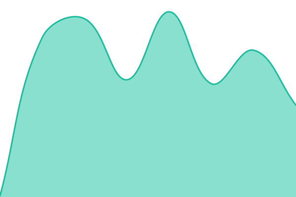
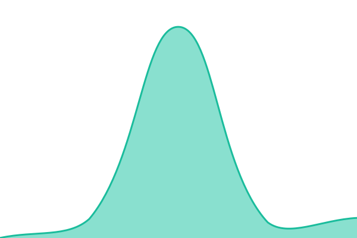
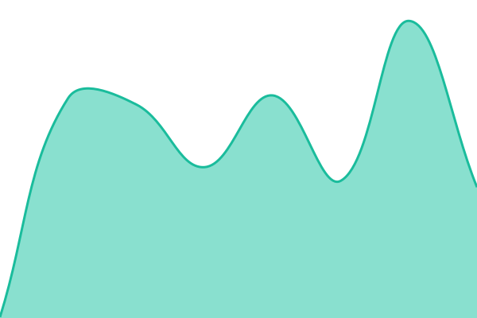

# [📈 Live Status](https://nick123pappas.github.io/status): <!--live status--> **🟩 All systems operational**

This repository contains the open-source uptime monitor and status page for [nick123pappas](https://nick123pappas.github.io/status), powered by [Upptime](https://github.com/upptime/upptime).

With [Upptime](https://upptime.js.org), you can get your own unlimited and free uptime monitor and status page, powered entirely by a GitHub repository. We use [Issues](https://github.com/nick123pappas/status/issues) as incident reports, [Actions](https://github.com/nick123pappas/status/actions) as uptime monitors, and [Pages](https://nick123pappas.github.io/status) for the status page.

<!--start: status pages-->
<!-- This summary is generated by Upptime (https://github.com/upptime/upptime) -->
<!-- Do not edit this manually, your changes will be overwritten -->
<!-- prettier-ignore -->
| URL | Status | History | Response Time | Uptime |
| --- | ------ | ------- | ------------- | ------ |
|  [Pappas Productions](https://pappasproductions.com) | 🟩 Up | [pappas-productions.yml](https://github.com/nick123pappas/status/commits/HEAD/history/pappas-productions.yml) | 

 163ms
     
 | 

<a href="https://nick123pappas.github.io/status/history/pappas-productions">100.00%</a>
    

|  [Texas Voter](https://texasvoters.app) | 🟩 Up | [texas-voter.yml](https://github.com/nick123pappas/status/commits/HEAD/history/texas-voter.yml) | 

 248ms
     
 | 

<a href="https://nick123pappas.github.io/status/history/texas-voter">100.00%</a>
    

|  [BlueSwell](https://blueswell.app) | 🟩 Up | [blue-swell.yml](https://github.com/nick123pappas/status/commits/HEAD/history/blue-swell.yml) | 

 510ms
     
 | 

<a href="https://nick123pappas.github.io/status/history/blue-swell">100.00%</a>
    

|  [Lucky Us](https://luckyusapp.app) | 🟩 Up | [lucky-us.yml](https://github.com/nick123pappas/status/commits/HEAD/history/lucky-us.yml) | 

 205ms
     
 | 

<a href="https://nick123pappas.github.io/status/history/lucky-us">100.00%</a>
    

|  [Dateworthy](https://dateworthy.pages.dev) | 🟩 Up | [dateworthy.yml](https://github.com/nick123pappas/status/commits/HEAD/history/dateworthy.yml) | 

 224ms
     
 | 

<a href="https://nick123pappas.github.io/status/history/dateworthy">100.00%</a>
    

<!--end: status pages-->

[**Visit our status website →**](https://nick123pappas.github.io/status)

## 📄 License

- Powered by: [Upptime](https://github.com/upptime/upptime)
- Code: [MIT](./LICENSE) © [Anand Chowdhary](https://anandchowdhary.com)
- Data in the `./history` directory: [Open Database License](https://opendatacommons.org/licenses/odbl/1-0/)
